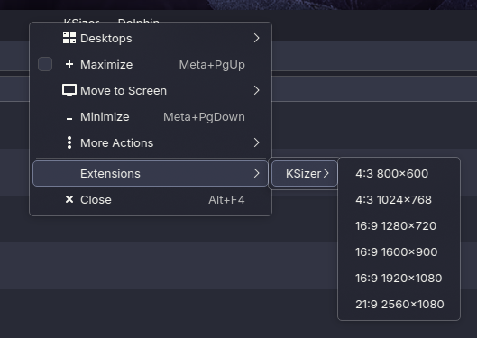

# KSizer

KSizer is a KWin script that adds resize presets to the window menu and to global keyboard shortcuts, letting you quickly size and center windows to saved dimensions.

## Screenshot

## Features
- Adds a "KSizer " submenu in the window menu.
- Resizes windows to preset widths and heights.
- Centers windows by default (configurable).
- Presets are configurable from System Settings.
- Each preset gets its own global keyboard shortcut, so one key press resizes the active window.
- Resize all windows of the focused app at once, arranged as a grid, a cascade, or a stack.

## Requirements
- KDE Plasma with KWin scripting support (Plasma 6 recommended).

## Install
1. Install the package with `kpackagetool6 --type=KWin/Script -i package`
   (use `-u` instead of `-i` to update an existing install).
   - Alternatively, copy the `package` directory to `~/.local/share/kwin/scripts/ksizer`
     (the folder name must match the plugin Id).
2. In System Settings, open Window Management > KWin Scripts.
3. Enable the script and click Configure to edit presets.
4. Click Apply.

## Usage
### From the window menu
1. Focus a window.
2. Open the window menu using `Alt+F3` or by right clicking the titlebar.
3. Open the "KSizer " submenu.
4. Pick a preset to resize and center the window.

### All windows of an app
The "All windows of this app (N)" submenu applies a preset to every window of the
focused app, where N is how many of its windows are on the current desktop.

- Only windows on the current desktop and activity are included.
- Dialogs, transient windows, and windows hidden from the taskbar are skipped.
- Maximized, fullscreen, and tiled windows are restored and resized too.
- Minimized windows are resized but stay minimized. They take no slot in the layout.
- Windows are arranged per screen, starting with the window you invoked it on.
- The submenu is not shown for windows that would be skipped themselves, such as dialogs.

The arrangement is set in the configuration UI:
- Cascade: each window is offset slightly from the previous one, centered on the screen.
- Grid (default): windows are placed next to each other, centered on the screen.
  If they do not fit at the preset size, Cascade is used instead.
  "Grid spacing" sets the gap in pixels between windows (0 by default, so they touch).
  The gap counts when checking whether the windows fit.
- Stack: every window is placed as if resized alone.

How the "Center windows" setting applies:
- Cascade and Grid always center the arrangement and ignore the setting.
- Stack, minimized windows, and a screen with only one of the app's windows use the
  single-window placement, which follows the setting: centered when enabled, current
  position kept when disabled. With centering enabled, Stack puts the windows on top
  of each other.

The window you invoked it on is raised so it ends up on top.

Apps with a minimum size larger than the preset keep their minimum size.

### With keyboard shortcuts
Each preset registers a global shortcut named `KSizer: Preset N`,
where N is the preset's position in the list.
A second shortcut, `KSizer: Preset N (All windows)`, resizes all windows of the active app.
No keys are bound by default, so nothing conflicts with your existing shortcuts.

1. Open System Settings > Keyboard > Shortcuts.
2. Select Window Management and search for "KSizer".
3. Bind a key to each preset you want, for example `Meta+Alt+1` for Preset 1.
4. Focus a window and press the key to resize it.

Shortcuts follow the preset's position, not its label.
If you reorder presets, a key triggers whichever preset is now in that position.

## Configuration
- Presets are stored under the `Presets` key in the script config.
- Centering is enabled by default and can be changed in the configuration UI.
- The all-windows arrangement is stored under the `AllWindowsArrangement` key
  (`Cascade`, `Grid`, or `Stack`).
- The grid gap is stored under the `GridSpacing` key (pixels, 0 to 200).
- After changing presets, toggle the script off/on to refresh the menu and shortcuts.

## Project Layout
- `package/metadata.json`: KWin package metadata.
- `package/contents/code/main.js`: main script entrypoint.
- `package/contents/config/main.xml`: KConfigXT schema for presets.
- `package/contents/ui/config.ui`: configuration UI.

## Development
No build, lint, or test tooling is configured.

Manual testing:
1. Enable or reload the script in System Settings > Window Management > KWin Scripts.
2. Open any window, press `Alt+F3`, and select a preset.
3. Press a bound `KSizer: Preset N` shortcut on a focused window.
4. Verify the window resizes and centers within the available area.
5. Open several windows of one app, use "All windows of this app", and check each arrangement.

## License
GPL-3.0-or-later. See `LICENSE`.

## Support
If KSizer helps your workflow, you can support development here:
https://buymeacoffee.com/allenguarnes
