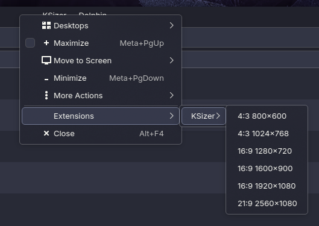

# KSizer

KSizer is a KWin script that adds resize presets to the window menu, letting you quickly size and center windows to saved dimensions.

## Screenshot

## Features
- Adds a "KSizer " submenu in the window menu.
- Resizes windows to preset widths and heights.
- Centers windows by default (configurable).
- Presets are configurable from System Settings.
- Each preset gets a global shortcut you can bind.

## Requirements
- KDE Plasma with KWin scripting support (Plasma 6 recommended).

## Install
1. Install the package with `kpackagetool6 --type=KWin/Script -i package`
   (use `-u` instead of `-i` to update an existing install).
   - Alternatively, copy the `package` directory to `~/.local/share/kwin/scripts/ksizer`
     (the folder name must match the plugin Id).
2. In System Settings, open Window Management > KWin Scripts.
3. Enable the script and click Configure to edit presets.
4. Click Apply.

## Usage
1. Focus a window.
2. Open the window menu using `Alt+F3` or by right clicking the titlebar.
3. Open the "KSizer " submenu.
4. Pick a preset to resize and center the window.

### Keyboard shortcuts
Each preset registers a shortcut named `KSizer: Preset N`, where N is its position in the list.
No keys are bound by default. Bind them in System Settings > Keyboard > Shortcuts > KWin.
The shortcut acts on the active window.

## Configuration
- Presets are stored under the `Presets` key in the script config.
- Centering is enabled by default and can be changed in the configuration UI.
- After changing presets, toggle the script off/on to refresh the menu and shortcuts.

## Project Layout
- `package/metadata.json`: KWin package metadata.
- `package/contents/code/main.js`: main script entrypoint.
- `package/contents/config/main.xml`: KConfigXT schema for presets.
- `package/contents/ui/config.ui`: configuration UI.

## Development
No build, lint, or test tooling is configured.

Manual testing:
1. Enable or reload the script in System Settings > Window Management > KWin Scripts.
2. Open any window, press `Alt+F3`, and select a preset.
3. Verify the window resizes and centers within the available area.

## License
GPL-3.0-or-later. See `LICENSE`.

## Support
If KSizer helps your workflow, you can support development here:
https://buymeacoffee.com/allenguarnes
